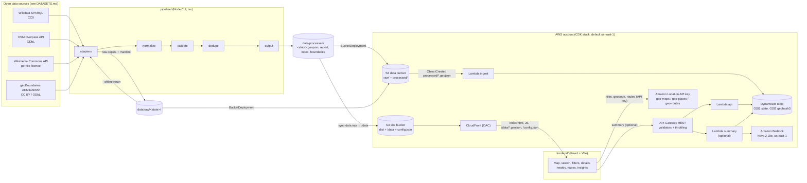

# HeritageTrail India: Architecture (Phase 2)

This document fixes the architecture, folder layout, record schema and interfaces for HeritageTrail India.
Data sources and their licences come from [DATASETS.md](DATASETS.md); nothing here adds a source that is not verified there.

## 1. Overview

HeritageTrail India is a map-first web app. A TypeScript pipeline pulls open heritage data (Wikidata, OpenStreetMap,
Wikimedia Commons, geoBoundaries), keeps the raw responses, normalizes and validates them into one schema, and writes
per-state GeoJSON. The React frontend renders that GeoJSON on an Amazon Location Service map. In AWS, the same files
are uploaded to S3, an ingest Lambda loads them into DynamoDB, and a REST API (API Gateway + Lambda) serves queries
and optional Amazon Bedrock summaries grounded in the stored source text.



Data flow in one line: **sources → pipeline → `data/raw` + `data/processed` → S3 → ingest Lambda → DynamoDB → API
Gateway → frontend**, and the frontend also loads the processed GeoJSON directly from CloudFront at `/data/`.

## 2. Design decisions

Each decision is binding for Phases 3 to 7. The rationale is one line.

| # | Decision | Rationale |
|---|---|---|
| 1 | npm workspaces with top-level `shared/`, `pipeline/`, `backend/`, `frontend/`, `infra/`, plus `config/`, `data/raw/`, `data/processed/`, `docs/`; one root `package-lock.json`. | One language (TypeScript) lets the pipeline, Lambdas and frontend share one schema. |
| 2 | `@heritagetrail/shared` is consumed as TypeScript source (`"exports": {".": "./src/index.ts"}`); each consumer transpiles it (tsx, Vite, esbuild, Vitest); typecheck with `tsc --noEmit`, `moduleResolution: "bundler"`. | Avoids a build step and project references. |
| 3 | Schema validation with zod in `shared/src/schema.ts`, used by pipeline output, ingest Lambda input and API query params. | One definition of a valid record at every trust boundary. |
| 4 | Pipeline in TypeScript run with `tsx`, Node 22 `fetch`, `@turf/*`, `fastest-levenshtein`; one adapter per source; states, sources and categories in JSON config. | Adding a state is a new `config/states/<slug>.json`; adding a source is an adapter file plus a `config/sources.json` entry. |
| 5 | Lambdas on Node.js 22.x (`NodejsFunction`), bundled by local esbuild (`forceDockerBundling: false`, `externalModules: []`). | Docker is usually not running on the 6 GB build host. |
| 6 | Amazon Location V2 standalone APIs (geo-maps, geo-places, geo-routes). The only Location resource is one `AWS::Location::APIKey` allowing `geo-maps:GetTile`, `geo-maps:GetStaticMap`, `geo-places:Geocode`, `geo-places:Autocomplete`, `geo-places:SearchText`, `geo-routes:CalculateRoutes` on `arn:aws:geo-maps|geo-places|geo-routes:<region>::provider/default`, with a referer allow-list (CloudFront domain; `http://localhost:5173/*`, `http://localhost:4173/*` in `dev` only). | V2 is the current developer guide and needs no map/place-index/route-calculator resources; the key is scoped to read-only actions. |
| 7 | Default region `us-east-1` (user's choice in Phase 5; overridable with `-c region=<r>`). Evidence in section 9. | All three Location V2 features and the Bedrock profile answer there, so the whole stack runs in one region; ap-south-1 was also verified and remains an option. |
| 8 | Bedrock in a separate configurable region: `bedrockRegion: "us-east-1"`, `bedrockModelId: "us.amazon.nova-2-lite-v1:0"`, `enableSummaries` flag. When false, no summary Lambda, route or IAM is synthesized. IAM grants `bedrock:InvokeModel` on the profile ARN plus its three foundation-model ARNs. | The model is verified on the user's account in us-east-1; the feature is optional. |
| 9 | Frontend always loads static GeoJSON from `/data/` (`index.json`, per-state files, boundaries), copied from `data/processed/` by `frontend/scripts/sync-data.mjs` in `predev`/`prebuild`. Map, clustering, search, filters, nearby and insights run client-side. The API is used only for the optional AI summary. | The app runs locally with no backend and the same files ship to CloudFront. |
| 10 | Runtime config: the frontend fetches `/config.json` (`region`, `locationApiKey`, `mapStyle`, `apiBaseUrl`, `summariesEnabled`), falls back to `import.meta.env.VITE_*`, then to local mode. CDK writes `config.json` with `BucketDeployment` + `Source.jsonData`, reading the key value with an `AwsCustomResource` calling `location:DescribeKey`. | No rebuild after deploy and no AWS credentials in frontend code. |
| 11 | Without a key the map uses `fallbackStyle.ts`: background colour plus local ADM1 state fill/line, no external tiles. With a key it uses `https://maps.geo.<region>.amazonaws.com/v2/styles/<Style>/descriptor?key=<key>`. Cluster counts are HTML markers. | Local testing needs no key and no glyph server. |
| 12 | Routing from the browser with `@aws-sdk/client-geo-routes` and `@aws/amazon-location-utilities-auth-helper` `withAPIKey(key, region)`, `LegGeometryFormat: "Simple"`; disabled with a message when no key is configured. | Routing needs no backend; it can only be tested live after deploy, so unit tests mock the client. |
| 13 | Categories `temple | fort | monument | museum | archaeological-site | other`, plus `unesco` (`inscribed | component | tentative | null`) and `unescoWhsId`. UNESCO sites get their own marker that overrides the category marker. Category mapping uses keyword rules on Wikidata P31 English labels and OSM tags in `config/categories.json`. | No hard-coded, unverified QIDs; mapping is data, not code. |
| 14 | Verification status `verified` / `unverified` / `rejected` (rules in section 5). Map shows verified by default with an "include unverified" toggle; insights "total verified" counts `verified`. | Users see what was checked and what was not. |
| 15 | Dedupe by Wikidata tag, normalized name within 300 m, and near-duplicate flagging within 50 m (section 5). | Merges the same site across sources without silently merging different sites. |
| 16 | IDs `wd-<QID>` or `osm-<type>-<id>` from the primary source. | Stable, traceable and URL-safe for API paths. |
| 17 | Deterministic output: no wall-clock timestamp in processed files; `metadata.dataRetrievedAt` is the latest `fetchedAt` in the raw manifest; `--offline` reproduces the committed file byte for byte. | Reproducible data and reviewable diffs. |
| 18 | Raw site responses committed in `data/raw/<state>/` with `manifest.json` (url, query sha256, fetchedAt, HTTP status, body sha256). Raw geoBoundaries files (13 MB) gitignored in `data/raw/boundaries/`. Committed processed boundaries: `india-states.geojson` (turf simplify 0.005, 5-decimal coordinates, < 1.5 MB), `<slug>-state.geojson` and `<slug>-districts.geojson` (exact polygons). Districts assigned to a state by `turf.pointOnFeature` inside the state polygon. | Provenance for every record; offline runs and tests need no large downloads. |
| 19 | DynamoDB single table (section 7). | All API access patterns are key lookups or queries; no scans. |
| 20 | REST API (API Gateway v1) with `RequestValidator` for required params and zod in the handler for types and ranges; stage throttling 20 rps / burst 40; CORS limited to the CloudFront origin (+ localhost in dev). Contract in section 8. | Validation at two layers and bounded abuse cost. |
| 21 | Three Lambdas with least-privilege IAM: `api`, `ingest` (S3 ObjectCreated on `processed/*.geojson`), `summary` (section 10). Summaries use only stored fields; with no description the handler returns 422 without calling Bedrock. | Each function can touch only what it needs; summaries stay grounded. |
| 22 | Vitest everywhere (`--maxWorkers=2`), `aws-sdk-client-mock` for handlers, React Testing Library + jsdom with `maplibre-gl` mocked, Playwright (chromium) smoke test against `vite preview`, `aws-cdk-lib/assertions` for IAM and API key checks. | Fits the 6 GB host and covers each layer. |
| 23 | MIT for source code only if the production dependency audit shows only permissive licences; data keeps its own licences in `data/LICENSE-DATA.md` (processed GeoJSON ODbL 1.0 because it merges OSM; boundaries CC BY / ODbL; images per file, linked not copied). If a copyleft or unknown production dependency appears, no LICENSE file is added and README explains why. | Code and data licences are separate decisions. |

## 3. Folder structure

```text
.
├─ package.json            npm workspaces root; scripts typecheck, test, pipeline, synth
├─ tsconfig.base.json      strict, ES2022, module ESNext, moduleResolution bundler
├─ .nvmrc                  22
├─ config/
│  ├─ sources.json         endpoints, licences, attribution, Overpass tag filters
│  ├─ categories.json      ordered keyword/tag rules → Category
│  └─ states/<slug>.json   one file per state (tamil-nadu.json first)
├─ shared/                 @heritagetrail/shared: zod schema, config schemas, geo utils, ids
│  ├─ src/{schema,config,geo,ids,index}.ts
│  └─ test/
├─ pipeline/               Node CLI (tsx): run --state <slug> [--offline] [--sources a,b], boundaries
│  └─ src/{http,rawStore,config,paths,geojson,normalize,validate,dedupe,output,run,cli}.ts, src/adapters/{types,wikidata,osm,commons,boundaries}.ts
├─ data/
│  ├─ raw/<state>/<source>/*.json + manifest.json   committed raw responses
│  ├─ raw/boundaries/                               gitignored geoBoundaries downloads
│  └─ processed/<state>.geojson, <state>.report.json, index.json, boundaries/*.geojson
├─ frontend/               React + Vite + Tailwind + Framer Motion + MapLibre GL
│  ├─ scripts/sync-data.mjs  copies data/processed → public/data (gitignored)
│  ├─ src/{config,data,domain,map,components,state}/
│  └─ e2e/                 Playwright smoke test
├─ backend/                Lambda handlers
│  ├─ src/lib/{ddb,repo,params,http}.ts
│  ├─ src/handlers/{api,ingest,summary}.ts
│  └─ test/
├─ infra/                  AWS CDK (TypeScript)
│  ├─ bin/app.ts, config/environments.ts, lib/heritage-stack.ts + constructs
│  ├─ scripts/check-region.ts   read-only region capability check
│  └─ test/
└─ docs/                   DATASETS.md, ARCHITECTURE.md, SECURITY.md
```

## 4. Record schema

Each site is a GeoJSON `Feature` with `Point` geometry in `[longitude, latitude]` order. Properties
(`HeritageSiteProperties` in `shared/src/schema.ts`):

| Field | Type | Source / rule |
|---|---|---|
| `id` | `wd-Q\d+` or `osm-(node\|way\|relation)-\d+` | Primary source identifier (decision 16) |
| `name` | string | Wikidata English label, else OSM `name:en` / `name` |
| `state`, `stateCode` | string, `IN-XX` | From the state config; confirmed by point-in-polygon against geoBoundaries ADM1 |
| `district` | string or null | Wikidata P131 district, cross-checked or filled from ADM2 point-in-polygon |
| `category` | `temple \| fort \| monument \| museum \| archaeological-site \| other` | `config/categories.json` rules |
| `unesco` | `inscribed \| component \| tentative \| null` | Wikidata P1435 designation labels |
| `unescoWhsId`, `unescoUrl` | string or null | Wikidata P757; URL `https://whc.unesco.org/en/list/<id>` (UNESCO data itself is never ingested) |
| `designations` | string[] | Wikidata P1435 labels |
| `asiMonumentId` | string or null | Wikidata P1371 |
| `period` | `{label, year\|null, source}` or null | Wikidata P571 inception, OSM `start_date`; null means unknown |
| `description` | `{text, source, license}` or null | Wikidata `schema:description` (CC0) only; no Wikipedia text |
| `image` | `{url, thumbUrl, filePageUrl, license, licenseUrl, artist, credit}` or null | Wikidata P18 + Commons imageinfo; dropped unless licence and author resolve |
| `sources` | `SourceRef[]` (min 1): `{name, id, url, license, licenseUrl, retrievedAt}` | Every contributing source record |
| `license` | string | Record licence (`CC0-1.0` for Wikidata-only, `ODbL-1.0` when OSM contributed) |
| `verificationStatus` | `verified \| unverified \| rejected` | Section 5 |
| `flags` | string[] | `missing-district`, `missing-period`, `missing-description`, `missing-image`, `district-derived`, `district-mismatch`, `coordinate-conflict`, `boundary-tolerance`, `possible-duplicate:<id>` |

The `FeatureCollection` carries `metadata`: `state`, `stateCode`, `dataRetrievedAt`, `sources[]` (id, name, url,
licence, licence URL, record count), `attribution[]`, `databaseLicense` (ODbL 1.0) and `counts` (total, verified,
unverified, rejected, byCategory). Rejected records are never in the collection; they are listed in
`<state>.report.json` with the reason.

## 5. Validation, verification status and dedupe

**Coordinate checks.** India bounding box lon 68.0 to 97.5, lat 6.0 to 37.5; then the claimed state's ADM1 polygon
with a 2 km tolerance for coastal and border points.

**Verification status.**

- `verified`: inside the claimed state polygon (or within 2 km of its edge, flagged `boundary-tolerance`), name and
  coordinates present, and either an ASI Monument ID or WHS ID, or two sources agree within 500 m.
- `unverified`: inside the state but single-source with no identifier.
- `rejected`: outside the India bbox, outside the claimed state beyond tolerance, or no coordinates. Excluded from the
  GeoJSON and reported.

**District.** Wikidata district is compared with the ADM2 polygon containing the point (Levenshtein ratio ≥ 0.8 on
normalized names). Match: use the ADM2 spelling. No Wikidata district: take ADM2 and flag `district-derived`.
Disagreement: keep Wikidata (spelled as the closest ADM2 name when one matches), flag `district-mismatch`, and list
the pair in the report. Evidence for keeping Wikidata: in the 2026-10-30 run, 63 of the 75 mismatches came from
geoBoundaries ADM2 having the names Kancheepuram and Chengalputtu swapped (an interior point of the ADM2
"Chengalputtu" polygon lies in OSM's Kanchipuram district, Q15157, and vice versa for Chengalpattu, Q65976177).
Consumers that join sites to district polygons by name must account for that swap.

**Dedupe.**

1. An OSM element whose `wikidata` tag equals a Wikidata QID merges into that Wikidata record.
2. Same normalized name (NFD, diacritics stripped, lowercase, punctuation removed) within 300 m merges.
3. Different names within 50 m with the same category are flagged `possible-duplicate:<id>`, not merged.

In merges Wikidata coordinates win; a disagreement over 500 m adds `coordinate-conflict`. Merged records keep every
`SourceRef`.

## 6. Pipeline and configuration

`npm run pipeline -- run --state <slug> [--offline] [--sources a,b]` and `npm run pipeline -- boundaries`.

- `config/states/<slug>.json`: slug, ISO code, name, Wikidata QID, OSM `ISO3166-2` value, geoBoundaries `shapeISO`,
  expected district count, and the ASI centrally protected count with its source and date (Tamil Nadu: 412,
  `https://asi.nic.in/pdf/CPM_List.pdf`, 2025-04-08), used only for a coverage-gap figure in the report.
- `config/sources.json`: per source the endpoint, terms URL, licence, licence URL, attribution text and provenance
  note, plus Overpass tag filters (`historic` = fort, castle, monument, archaeological_site, ruins, temple;
  `tourism=museum`; `amenity=place_of_worship` with `historic`, excluding `historic` = memorial, boundary_stone,
  wayside_cross, wayside_shrine, milestone; unnamed elements are skipped).
- `config/categories.json`: ordered rules (museum, fort, temple, archaeological-site, monument, fallback `other`).
- HTTP: identifying User-Agent, retry with 30 s backoff on 429/502/503/504, max 3 attempts. If Overpass still fails
  the run continues and the report records the failure.

All three config files are validated with zod schemas in `shared/src/config.ts`.

**Adding a state** needs only `config/states/<slug>.json`, then `npm run pipeline -- boundaries` (writes
`<slug>-state.geojson` and `<slug>-districts.geojson` and checks `expectedDistrictCount`) and
`npm run pipeline -- run --state <slug>`. **Adding a site source** needs an adapter implementing `SourceAdapter`
(`pipeline/src/adapters/types.ts`: `fetch(state, ctx)` through the raw store, `normalize(raw, state)` to
`CandidateRecord[]`), one line in `SITE_ADAPTERS` (`pipeline/src/run.ts`) and an entry in `config/sources.json`.

Raw copies: each response is stored verbatim with a manifest entry; `--offline` re-reads them, refusing a copy whose
request (`querySha256`) or body (`bodySha256`) no longer matches. `data/**` has `-text` in `.gitattributes` so line
endings never change the bytes.

## 7. DynamoDB key design

Single table, on-demand billing, point-in-time recovery on.

| Item | `pk` | `sk` | GSI1 (`gsi1pk` / `gsi1sk`) | GSI2 (`gsi2pk` / `gsi2sk`) |
|---|---|---|---|---|
| Site | `SITE#<id>` | `META` | `STATE#<code>` / `<category>#<normName>#<id>` | `GH3#<geohash3>` / `<id>` |
| State stats | `STATS#<code>` | `META` | | |
| Summary cache | `SITE#<id>` | `SUMMARY#<modelId>` | | |

Nearby queries GSI2 for the centre geohash cell plus its 8 neighbours (precision 3, about 156 km cells, enough for
radius ≤ 100 km), then filters by haversine distance. Ingest writes in chunks of 25 with `UnprocessedItems` retry,
deletes items of the state that are no longer present, and writes the stats item.

## 8. API contract

REST API (API Gateway v1). Errors are JSON `{ "error": "<code>", "message": "<text>" }` without stack traces or
echoed input.

| Method and path | Parameters (validated) | Response |
|---|---|---|
| `GET /sites` | `state` (`IN-XX`), `category`, `period`, `q`, `limit` 1-200, `nextToken` | `{ items: HeritageFeature[], nextToken? }` |
| `GET /sites/{id}` | `id` matches `^(wd-Q\d+\|osm-(node\|way\|relation)-\d+)$` | `HeritageFeature` or 404 |
| `GET /sites/nearby` | `lat` 6-37.5, `lon` 68-97.5, `radiusKm` 1-100 (all required) | `{ items: (HeritageFeature & {distanceKm})[] }` sorted by distance |
| `GET /stats` | `state` | `{ total, verified, byCategory, byDistrict }` |
| `POST /sites/{id}/summary` | `id` as above; only when `enableSummaries` | `{ summary, aiGenerated: true, modelId, sources[] }`, or 422 `insufficient_source_text` |

## 9. Frontend modes and region evidence

**Local mode** (no `/config.json` key): static GeoJSON from `/data/`, fallback basemap from local state boundaries,
all features except routing, place search and AI summaries. Routing shows "requires Amazon Location API key".

**Deployed mode**: `/config.json` supplies region, API key, map style and API base URL. Tiles, geocoding and routes
are called directly from the browser with the API key; the summary call goes through API Gateway.

**Region verification (decision 7).** Read-only calls on 2026-10-30, account 466742534146:

- `geo-maps get-style-descriptor --style Standard` in ap-south-1 returned 138,433 bytes.
- `geo-places geocode "Thanjavur"` returned "Thanjavur, Tamil Nadu, India" at [79.12903, 10.76868].
- `geo-routes calculate-routes` from Chennai [80.2707, 13.0827] to Mahabalipuram [80.1989, 12.6175] returned
  58,013 m with a 1,370-point LineString (CLI flag `--leg-geometry-format Simple`).
- The same three calls also succeeded in us-east-1. Phase 2 picked ap-south-1 for latency; in Phase 5 the user chose
  us-east-1 as the deployment region. `npm run check:region -w infra` (read-only) passed in us-east-1: style
  descriptor 138,430 bytes, Thanjavur geocode at [79.12903, 10.76868], Chennai to Mahabalipuram 58,013 m with
  1,370 points, Bedrock profile ACTIVE with model regions us-east-1, us-east-2, us-west-2, no existing API keys.

**Bedrock verification (decision 8).** Read-only `aws bedrock get-inference-profile` showed
`us.amazon.nova-2-lite-v1:0` ACTIVE, routing to foundation-model ARNs in us-east-1, us-east-2 and us-west-2.

## 10. Security model (summary)

Full detail goes in `docs/SECURITY.md` (Phase 7).

- **No credentials in the frontend.** The browser holds only an Amazon Location API key restricted to the six read
  actions in decision 6 and to allowed referers. It cannot call any other AWS API.
- **Least-privilege IAM per Lambda.** `api`: DynamoDB `Query`/`GetItem` on the table and its GSIs. `ingest`: S3
  `GetObject` on `processed/*`, DynamoDB `BatchWriteItem`/`DeleteItem`/`Query`/`PutItem`. `summary`:
  `GetItem`/`PutItem` and `bedrock:InvokeModel` on the profile and its three model ARNs. No wildcard actions.
- **Input validation** at API Gateway (required params) and in handlers (zod types and ranges); IDs restricted by regex.
- **Abuse limits.** Stage throttling 20 rps / burst 40; CORS limited to the CloudFront origin (localhost only in dev).
- **Storage.** Buckets block public access, enforce TLS, use SSE-S3 and versioning; the site bucket is reached only
  through CloudFront origin access control; security headers policy on CloudFront.
- **Data.** Only public open data; no personal data. The Commons `Artist` field is kept only because the image licence
  requires attribution. Logs are structured and omit request bodies.
- **Bedrock data flow.** Summary prompts contain only stored public fields and are sent to us-east-1; the feature can
  be switched off with `enableSummaries: false`.
- **Secrets.** None in code, config or logs; the API key value is injected into `config.json` at deploy time.
