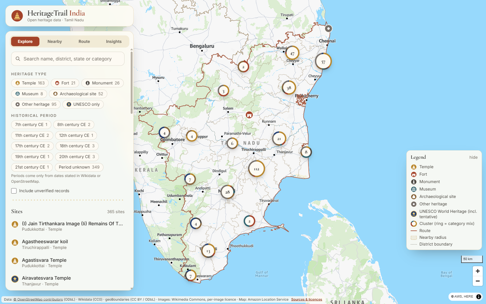
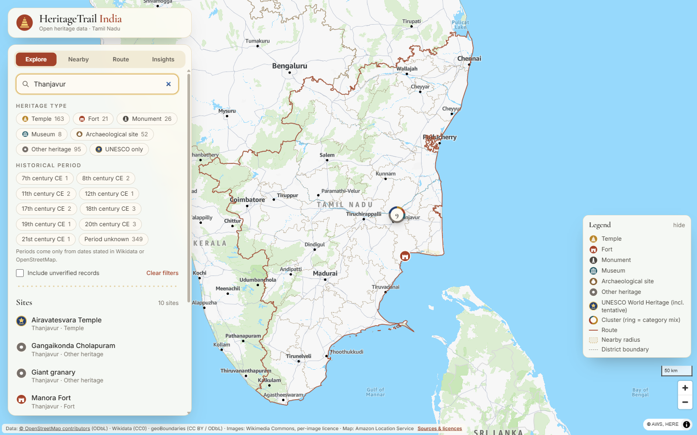
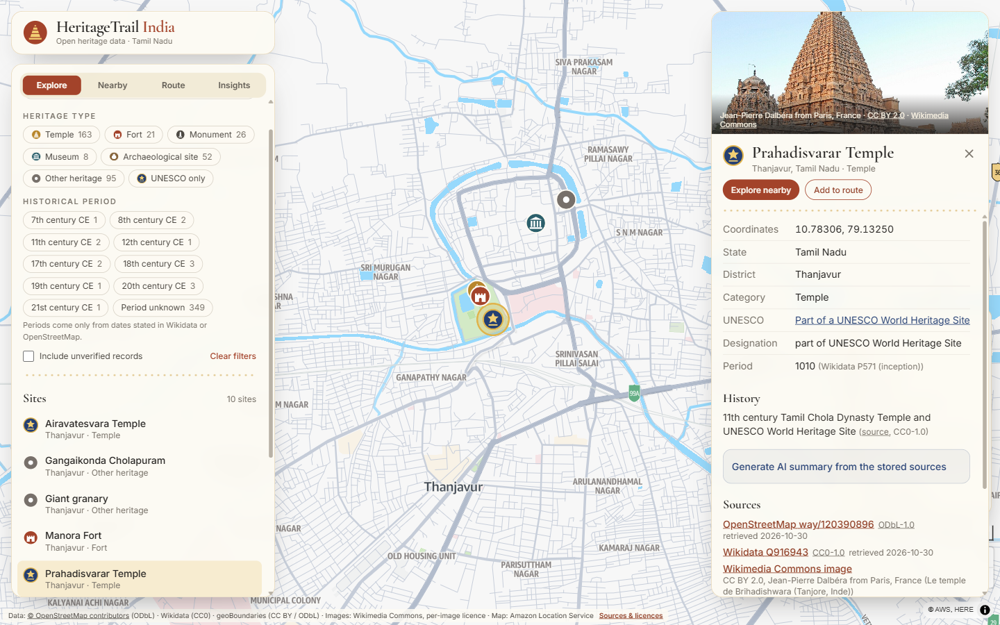
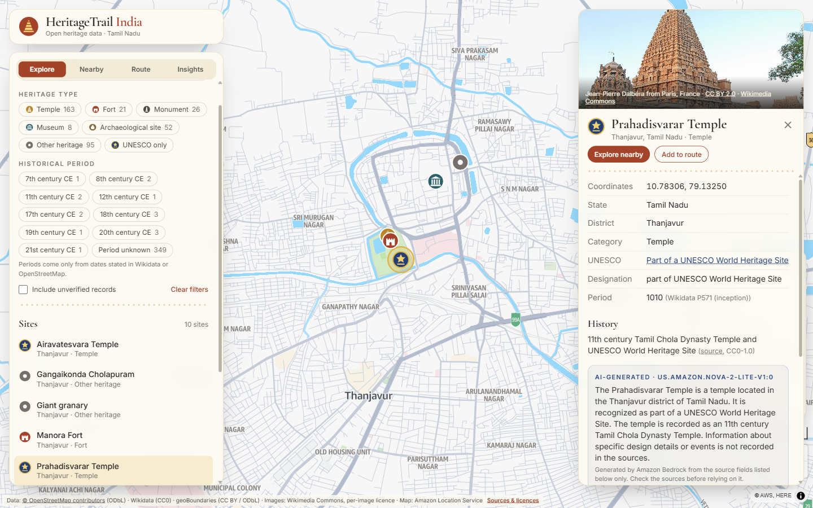
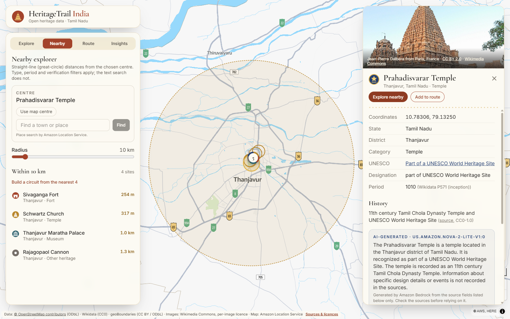
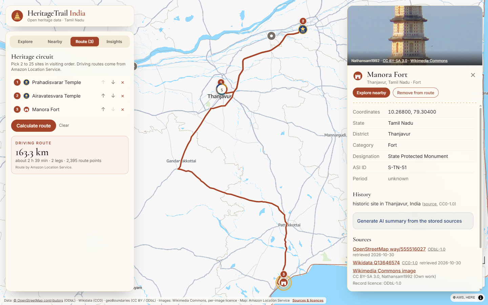
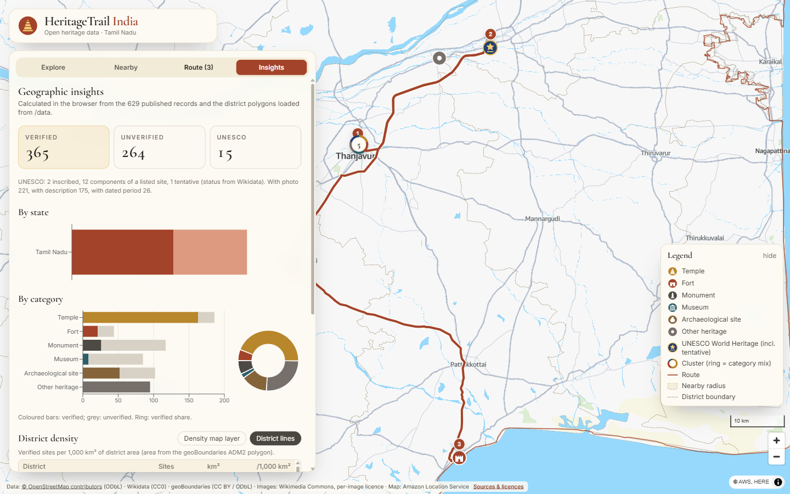

# Building HeritageTrail India: a map of Tamil Nadu's heritage from open data on AWS

**Live site:** https://d6thdya945lhl.cloudfront.net
**GitHub:** https://github.com/dineshrajdhanapathyDD/HeritageTrail-India

## Intro: why I built it

India has thousands of temples, forts, monuments and museums, but the information about them is scattered. One
website has the name, another has a photo, and the coordinates are often missing or wrong. I wanted one map where
anyone can open a state, see its heritage sites, tap a marker, read where the information came from, find what else
is nearby and plan a route between a few of them.

HeritageTrail India is that map. It starts with Tamil Nadu: **629 sites**, of which **365 are verified**. The
pipeline, API and frontend all work per state, so adding another state is mostly a configuration change.

One rule shaped the whole project: **no made-up data**. Every coordinate, description and photo comes from a source
I checked, and every record shows its source, licence and verification status. When something is uncertain, the app
says so instead of hiding it.

## What the app does

- **Heritage map:** an India map on Amazon Location Service, with different markers for temples, forts, monuments,
  museums, archaeological sites and UNESCO sites. Markers cluster as you zoom out, and state and district
  boundaries are drawn.
- **Search and filters:** search by name, state, district or category, and filter by type, historical period,
  UNESCO status and verification status.
- **Details panel:** name, coordinates, state, district, category, description, a Wikimedia Commons photo with its
  licence and author, source links and verification status.
- **Nearby explorer:** pick a radius and see the sites inside it, with distances, on the map.
- **Heritage routes:** select several sites and get the road route, its line on the map, distance and time from
  Amazon Location routing. For example, Arjuna Ratha to Alamparai Fort is 54.2 km, about 58 minutes.
- **Insights:** totals, sites by category and district, and a district density map layer, all computed from the
  ingested data.
- **AI summaries (optional):** a short summary from Amazon Bedrock (Amazon Nova 2 Lite), written only from the
  stored source text. It can be switched off at deploy time.

## Screenshots: a Thanjavur walkthrough

These are from the live site (https://d6thdya945lhl.cloudfront.net), captured with Playwright on 2026-10-30.

**1. Map overview.** Tamil Nadu's 365 verified sites, clustered. The ring around each cluster shows its mix of
categories.



**2. Search "Thanjavur".** The list narrows to the 10 verified sites in Thanjavur district, and the map shows only
those sites.



**3. Details: Prahadisvarar (Brihadisvara) Temple.** Shows the Commons photo with its author and licence, the
coordinates, the UNESCO status, the period (1010, from Wikidata), and the source links.



**4. AI summary.** Amazon Nova 2 Lite on Bedrock writes a summary only from the stored fields. It is labelled
AI-generated, and it says when the sources lack details.



**5. Nearby explorer.** Within 10 km of the temple are Sivaganga Fort (254 m), Schwartz Church (317 m), Thanjavur
Maratha Palace (1.0 km) and the Rajagopaol Cannon (1.3 km).



**6. Heritage route.** Prahadisvarar Temple → Airavatesvara Temple → Manora Fort is a 163.3 km drive, about
2 h 39 min over 2 legs. The route comes from Amazon Location Service.



**7. Insights.** 365 verified, 264 unverified and 15 UNESCO records, with breakdowns by state and category and a
district density table. All of it is computed from the published data.



## How I built it

I built it with Kiro, using a workflow of AI agents that worked through seven phases in order. Each phase was
committed and tagged in git, and code reviews ran before planning and before deployment.

### Phase 1: dataset research first

Before writing any code, each candidate source was checked against its own pages and terms: the AWS Registry of Open Data, ISRO Bhuvan, the
Archaeological Survey of India (ASI), the UNESCO World Heritage Centre and OpenStreetMap. Every page fetched was saved
so the claims in `docs/DATASETS.md` can be checked later. The result:

| Source | Used? | Why |
|---|---|---|
| Wikidata | Yes | CC0. Names, coordinates, districts, ASI monument IDs, UNESCO IDs, image file names |
| OpenStreetMap (Overpass API) | Yes | ODbL. Forts, temples, museums, and a second check on coordinates |
| Wikimedia Commons | Yes | Licence and author for each image. Images are linked, not copied |
| geoBoundaries (India ADM1/ADM2) | Yes | State and district boundaries, under CC BY and ODbL |
| UNESCO World Heritage Centre | No | Republishing needs prior written permission. Records only link to UNESCO pages |
| ASI | No | The monument list PDF has no coordinates and can't be reproduced without permission |
| ISRO Bhuvan | No | Terms forbid redistribution and bulk extraction |
| AWS Registry of Open Data | No | No India heritage dataset is listed |

### Phase 2: architecture

An npm workspaces monorepo with one shared record schema (zod) used by every part: `shared/`, `pipeline/`,
`frontend/`, `backend/` and `infra/`.

```text
Wikidata, OSM, Commons, geoBoundaries
        │
        ▼
pipeline (adapters → normalize → validate → dedupe) ──► data/raw + data/processed/<state>.geojson
        │
        ▼ cdk deploy
Browser ── CloudFront ── S3 (React app + GeoJSON)
   │                     S3 data bucket ── event ──► Ingest Lambda ──► DynamoDB
   ├── Amazon Location (maps, places, routes) with a restricted API key
   └── API Gateway ──► API Lambda (DynamoDB) / Summary Lambda (Bedrock, Nova)
```

### Phase 3: ingestion and validation pipeline

A Node CLI that, for each state:

1. Fetches from Wikidata, Overpass and Commons, and keeps the raw responses with a checksum manifest.
2. Normalizes every record to one schema.
3. Checks that each point is inside India and inside the claimed state, and works out or cross-checks the district
   from the boundary polygons.
4. Merges duplicates across sources (same Wikidata ID, or the same name within a short distance), and flags close
   matches it doesn't merge.
5. Flags missing period, description or image, and marks a record verified only when the evidence supports it.

An `--offline` run rebuilds the processed data from the saved raw files, byte for byte.

### Phase 4: the frontend

React, TypeScript, Vite, Tailwind CSS and Framer Motion, with MapLibre GL showing Amazon Location map tiles. The
design is heritage-inspired, with Cormorant Garamond and Inter fonts. The map takes up the screen, and on mobile the
details open in a bottom sheet. Without an API key the app still runs locally on a plain basemap with the committed
GeoJSON.

### Phase 5: backend and AWS infrastructure

One AWS CDK (TypeScript) stack: S3, CloudFront, API Gateway, three Node.js 22 Lambdas (API, Ingest, Summary),
DynamoDB, an Amazon Location API key and optional Bedrock access. Each Lambda gets only the permissions it uses. For
example, the API Lambda can only run DynamoDB `GetItem` and `Query`.

### Phases 6 and 7: tests, docs, deployment

There are 191 unit tests across the five workspaces and a Playwright browser test. The stack was deployed to
us-east-1 and tested live: the site, the map tiles, routing, every API endpoint and the Bedrock summary.

## Technology stack

| Layer | Tools |
|---|---|
| Frontend | React 19, TypeScript, Vite 8, Tailwind CSS 4, Framer Motion, MapLibre GL 6, Recharts, Turf.js |
| Maps and routing | Amazon Location Service (maps, places, routes) with an API key |
| Backend | AWS Lambda (Node.js 22, arm64), Amazon API Gateway (REST), Amazon DynamoDB |
| Storage and hosting | Amazon S3, Amazon CloudFront with Origin Access Control |
| AI | Amazon Bedrock, Amazon Nova 2 Lite (`us.amazon.nova-2-lite-v1:0`) |
| Infrastructure | AWS CDK v2 (TypeScript), Lambdas bundled with local esbuild (no Docker) |
| Data | Wikidata SPARQL, OpenStreetMap Overpass API, Wikimedia Commons API, geoBoundaries |
| Validation and tests | zod, Vitest, Testing Library, Playwright |
| Dev tooling | Kiro (agent workflows), npm workspaces, Git |

## Troubleshooting I ran into

**1. The best-known sources couldn't be used.** UNESCO, ASI and Bhuvan are the obvious places to start, but their
terms don't allow republishing. I used Wikidata's ASI monument IDs and UNESCO IDs to link back to them instead.

**2. Public APIs are unreliable.** The Overpass API often answers 502/504, and Wikidata times out on heavy queries.
The pipeline retries three times with a 30-second backoff, saves raw responses so it can rebuild offline, and
records any source failure in the report.

**3. The boundary data had two district names swapped.** In geoBoundaries ADM2, Kancheepuram and Chengalputtu have
each other's names. I confirmed this against OpenStreetMap. It caused 63 of the 75 district mismatches. Records keep
the Wikidata district, and the app shows a note for those two districts.

**4. Sources disagreed on coordinates.** Six sites had Wikidata and OSM points far apart. Sankagiri Fort was 49 km
off. These records are now always marked unverified, even when they have an ASI or UNESCO ID, which brought the
verified count from 371 down to 365. One record, the Western Ghats, was rejected because its point is in Kerala.

**5. Git line endings on Windows.** Git's `autocrlf` setting converts line endings on checkout, which would stop
offline rebuilds and raw-file checksums from matching byte for byte. A `.gitattributes` rule (`data/** -text`) was
added before any data was committed.

**6. A security advisory in the map library.** `npm audit` reported a critical XSS advisory for maplibre-gl 6.4.0 and
earlier. Upgrading to v6.16 meant switching to its ESM-only exports and setting the worker URL by hand. Its CSS also
overrode Tailwind v4 utilities, which needed a layout fix.

**7. Flaky tests.** One map test failed under load, and on a clean install 10 frontend tests failed because the
jest-dom matchers weren't registered. Both were fixed: the test now waits properly, and the matchers are registered
explicitly.

**8. Low memory and Docker.** My machine has about 6 GB of RAM, and Docker-based CDK bundling is heavy. The Lambdas
are bundled with the local esbuild binary, so `cdk synth` and `cdk deploy` work with Docker stopped.

**9. A shared AWS account setting.** The CDK template would have replaced the account-wide API Gateway CloudWatch
role in us-east-1, which another of my stacks (RoadGuard) owns. I deployed with `cloudWatchRole: false`, so that
setting stayed as it was.

**10. The licence checker didn't see the workspaces.** `license-checker` only saw the empty root package in an npm
workspaces repo. I wrote a small script based on `npm ls` instead. It checked 180 production packages and found
none that are copyleft-only or unlicensed.

## What I learned

- **Research the data before the code.** Checking licences first saved me from building on sources I couldn't
  legally publish.
- **Open data needs cross-checking.** Comparing Wikidata, OSM and boundary polygons found errors that no single
  source showed, including the swapped district names.
- **Show uncertainty openly.** A "verified" or "unverified" label with sources is more useful than a clean-looking
  map that hides gaps. In Tamil Nadu, 603 of 629 sites have no historical period and 408 have no image, and the app
  says so.
- **Keep raw copies.** Saving source responses made the pipeline repeatable and testable without the network.
- **Amazon Location's API keys keep the frontend simple.** The browser calls maps, places and routes with a
  restricted key and no AWS credentials.
- **Ground the AI in stored text.** The Bedrock summary is given only the fields already in the record and their
  sources, and it is labelled as AI-generated. A prompt can't fully stop a model from adding things, so the label
  and source links matter.

## Pricing

Everything is serverless and billed by usage. There are no NAT gateways, VPCs or provisioned capacity. For a demo
with light traffic, I expect a few dollars a month at most, and often it stays within the AWS Free Tier. This is an
estimate, not a measured bill.

What costs money:

| Service | What it's billed for |
|---|---|
| Amazon Location Service | Map tile, place search and route requests (free tier first, then per 1,000 requests) |
| AWS Lambda | Requests and compute time |
| Amazon API Gateway | REST API requests |
| Amazon DynamoDB | On-demand reads and writes, plus point-in-time recovery storage on a table of a few MB |
| Amazon S3 and CloudFront | Storage, requests and data transfer |
| Amazon Bedrock | Nova 2 Lite tokens, only when someone asks for a summary |
| CloudWatch Logs | Log storage, kept for 30 days |

To stop all charges, run `npx cdk destroy -c env=dev` from `infra/`. This empties the buckets and deletes the stack.

## Conclusion

HeritageTrail India shows that you can build a useful heritage map from open data, provided you check every source,
keep the provenance, and are honest about the gaps. The Tamil Nadu data covers 629 sites, but it also shows what's
missing: 149 of the 412 centrally protected ASI monuments in Tamil Nadu aren't in open data yet, and most sites have
no recorded period.

Next steps:

- Add more states, starting with neighbouring ones.
- Fill gaps by contributing missing coordinates and images back to Wikidata and Commons.
- Add a custom domain and a production stage.

## Links

- **Live website:** https://d6thdya945lhl.cloudfront.net
- **GitHub repository:** https://github.com/dineshrajdhanapathyDD/HeritageTrail-India
- **Dataset research:** [docs/DATASETS.md](DATASETS.md)
- **Architecture:** [docs/ARCHITECTURE.md](ARCHITECTURE.md)
- **Security:** [docs/SECURITY.md](SECURITY.md)
